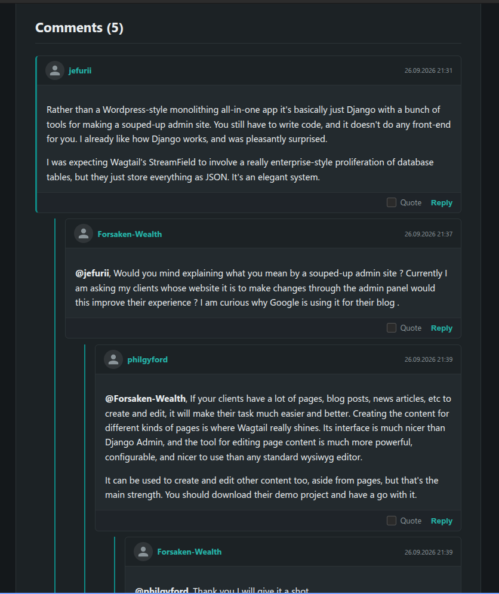

# wagtail-mptt-comments

**Threaded comments and moderation for Wagtail CMS.** The package stores comments as a nested MPTT tree, includes guest anti-spam controls, provides a Wagtail admin moderation interface, and exposes template tags for the comment form/tree and recent-comment widgets.

Use this package for article/page comments. It is not a forum engine and does not provide topics, sections, or private messages.

[English](README.md) · [Русский](README.ru.md) · [Deutsch](README.de.md) · [Español](README.es.md) · [Français](README.fr.md) · [Italiano](README.it.md) · [Português (Brasil)](README.pt-BR.md) · [Nederlands](README.nl.md) · [Polski](README.pl.md) · [Türkçe](README.tr.md) · [简体中文](README.zh-CN.md) · [日本語](README.ja.md) · [한국어](README.ko.md)



## Features

- Nested replies powered by `django-mptt`, with configurable depth.
- Guest anti-spam checks: honeypot, a signed page-bound form token, a signed math challenge, and per-session replay detection. These are layered friction/rate-limit controls, not a replacement for a WAF or abuse monitoring.
- Optional moderation for new comments and email notifications to administrators.
- User, guest, moderator, and administrator badges; optional notification to a comment author when someone replies.
- Wagtail admin list and tree views, bulk approve/delete actions, and administrator responses.
- Template tags for rendering a page's comments and a latest-comments sidebar.
- Multi-site filtering so page comments and recent-comment widgets are restricted to the current Wagtail Site.
- CSS variables for front-end theming, and a Prose-based editor for comment/admin-response content.

## Audit/release status

This source bundle prepares version `0.2.5` for a possible next release. Static syntax/package checks have been run, but a full Django/Wagtail integration suite has not run in the bundle build environment. Do not upload to PyPI until the release checklist in `../../04-docs/UPGRADE_AND_RELEASE.md` is complete.

## Requirements and installation

Package metadata declares `wagtail>=6.0`, `django-mptt>=0.16.0`, `django-prose-editor>=0.26`, and `nh3>=0.2.14`.

```bash
pip install wagtail-mptt-comments
```

To install **the candidate source in this bundle** (rather than the already-published PyPI release), run from this package directory:

```bash
python -m pip install .
# For editable development instead:
python -m pip install -e .
```

`pip install wagtail-mptt-comments` selects the version currently published on PyPI. The candidate version shown in `pyproject.toml` is not published by this archive operation; publish it only after the release checklist in `../../04-docs/UPGRADE_AND_RELEASE.md` passes.


Add the app after its dependencies:

```python
INSTALLED_APPS = [
    # ... Django and Wagtail apps ...
    "mptt",
    "django_prose_editor",
    "wagtail_mptt_comments",
]
```

Include the URL namespace:

```python
from django.urls import include, path

urlpatterns = [
    # ...
    path("comments/", include("wagtail_mptt_comments.urls")),
]
```

Apply the package migrations:

```bash
python manage.py migrate wagtail_mptt_comments
```

The package does not require a custom Wagtail Page model. Your commentable page is passed to the template tag.

## Render comments in a page template

```django


<h1>{{ page.title }}</h1>

```

`render_comments` supplies the approved comment tree and form. Avoid preparing the same tree/count/form in `Page.get_context()` as well; duplicate preparation causes repeated database work and can diverge from plugin behavior.

## Recent-comments widget

```django



<ul>
  
    <li>
      <a href="#comment-{{ comment.id }}">
        <strong>{{ comment.display_author_name }}</strong>:
        {{ comment.content|striptags|truncatewords:10 }}
      </a>
    </li>
  
</ul>
```

The template tag is intended for the current Wagtail Site. Keep it in a request context where the current `request` and Site are available. If your project has custom domain routing or serves content outside a configured Wagtail Site, verify that the widget returns no cross-site comments rather than broadening to all sites.

## Settings

All settings are optional. Current defaults in the package source are:

| Setting | Default | Meaning |
|---|---:|---|
| `COMMENTS_MODERATION` | `True` | Guest comments require moderation by default. |
| `COMMENTS_NOTIFY_ADMINS` | `False` | Email administrators about new comments. |
| `COMMENTS_MODERATOR_GROUPS` | `None` | Django group names whose members receive the moderator badge/role. |
| `COMMENTS_MAX_LENGTH` | `20000` | Maximum comment text length. |
| `COMMENTS_CAPTCHA_MAX_AGE` | `7200` seconds | Maximum age of the signed math-captcha token. |
| `COMMENTS_FORM_TOKEN_MAX_AGE` | `7200` seconds | Maximum age of the signed page-bound form token. |
| `COMMENTS_TRUST_PROXY_HEADERS` | `False` | Allow reading a forwarded client-IP chain, but only when `REMOTE_ADDR` matches a trusted proxy network. |
| `COMMENTS_TRUSTED_PROXY_IPS` | `()` | Comma-separated IP addresses/CIDRs of trusted reverse proxies. Never use `0.0.0.0/0` or `::/0`. |
| `SITE_NAME` | project-dependent | Site name used in messages where needed. |
| `DEFAULT_FROM_EMAIL` | Django default | Sender address for notifications. |

Example:

```python
COMMENTS_MODERATION = True
COMMENTS_NOTIFY_ADMINS = True
COMMENTS_MODERATOR_GROUPS = ["Moderators"]
COMMENTS_MAX_LENGTH = 20_000
COMMENTS_TRUST_PROXY_HEADERS = False  # keep false until proxy behavior is verified
COMMENTS_TRUSTED_PROXY_IPS = ()  # e.g. ("10.0.0.10/32",) after confirmation
DEFAULT_FROM_EMAIL = "noreply@example.com"
```

Set up Django email delivery if notifications are enabled. Review the content and privacy requirements for storing commenter names, email addresses, IP-derived rate-limit data, and notification preferences.

**Reverse proxy / rate limiting:** keep `COMMENTS_TRUST_PROXY_HEADERS=False` unless the hosting provider confirms the proxy address range and confirms that `X-Forwarded-For` is overwritten or appended safely. Then set `COMMENTS_TRUST_PROXY_HEADERS=True` and list only the provider proxy IPs/CIDRs in `COMMENTS_TRUSTED_PROXY_IPS`. The package ignores forwarded headers from untrusted peers and walks the chain from right to left. Do not trust arbitrary client-supplied XFF headers.

## Styling

Load the package's `comments.css` and override CSS custom properties in your theme stylesheet. For example:

```css
.article-comments {
  --mptt-bg: #1c2226;
  --mptt-card-bg: #1c2226;
  --mptt-accent: #0e8a86;
  --mptt-accent-hover: #26b5a9;
  --mptt-text: #eaeef0;
  --mptt-border: #2c3437;
}
```

Use your actual wrapper selector, and load the override after the plugin stylesheet.

## Security and operations

- Keep `nh3` and the package dependencies updated. Do not render user-authored HTML with `|safe` in custom templates.
- Test guest posting, CSRF, replay attempts in one session, moderation, reply links, email, and collection/site separation with normal users, moderators, and administrators. Cached HTML may be reused across visitors; replay tracking is per session so one visitor does not invalidate another visitor's copy of a cached challenge.
- When using multiple Wagtail Sites, test the latest-comments widget on every domain, including an unknown/unconfigured host.
- The source bundle does not include an automated test suite or a complete runtime compatibility matrix. Run migrations and smoke tests against your exact production dependencies before upgrading.

## Recommended combinations

- **`wagtail-prose-editor-images`** is useful if administrator responses or related Prose fields need the Wagtail Image Chooser. The packages are separately installable; test the exact field configuration.
- **`wagtail-image-directories`** complements this package only when the site also needs structured image storage; comments themselves do not require it.
- Use **`wagtail-simple-forum`** for discussion boards and private messages, not as a replacement for article comments.

## License and support

MIT. Source and issue tracker: [GitHub](https://github.com/vovansrnd/wagtail-mptt-comments). Do not include commenter personal data, production tokens, or private URLs in bug reports.
